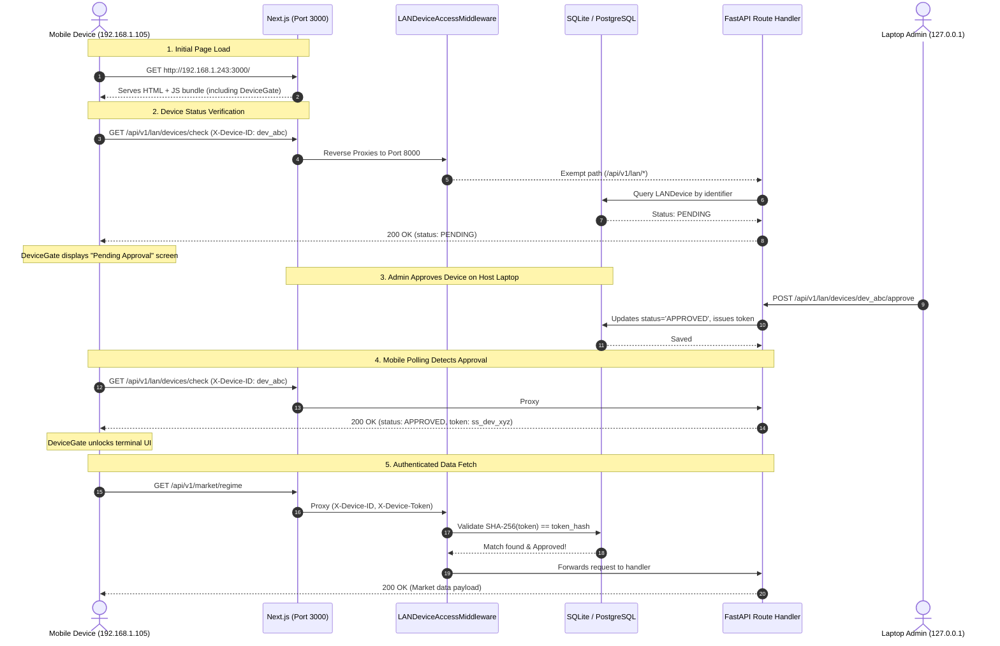

# StockSense AI — LAN Architecture & Packet Flow (Native / No Docker)

This document provides a technical walkthrough of StockSense AI's native Windows LAN server architecture, internal reverse proxy mechanisms, request lifecycle, and component interactions.

---

## 1. System Topology

```
                       WINDOWS LAPTOP HOST (SERVER)
 ┌────────────────────────────────────────────────────────────────────────┐
 │                                                                        │
 │   Next.js Unified Web Server (Port 3000, 0.0.0.0)                      │
 │   ┌────────────────────────────────────────────────────────────────┐   │
 │   │  • Serves React / Next.js Terminal UI                          │   │
 │   │  • DeviceGate Perimeter Interceptor Component                  │   │
 │   │  • Internal Reverse Proxy Rewrites:                            │   │
 │   │      /api/v1/*   ──►  http://127.0.0.1:8000/api/v1/*           │   │
 │   │      /docs       ──►  http://127.0.0.1:8000/docs               │   │
 │   │      /openapi    ──►  http://127.0.0.1:8000/openapi.json       │   │
 │   └───────────────────────────────┬────────────────────────────────┘   │
 │                                   │ Internal HTTP Proxy (Fast)         │
 │                                   ▼                                    │
 │   FastAPI Backend Server (Port 8000, 0.0.0.0)                          │
 │   ┌────────────────────────────────────────────────────────────────┐   │
 │   │  • LANDeviceAccessMiddleware (Central Device Gating)           │   │
 │   │  • Dynamic LAN CORS Engine (Loopback + Active LAN IPs)         │   │
 │   │  • Biometric Face Auth & JWT Security Subsystem                │   │
 │   │  • Multi-Market Canonical Data Endpoints                       │   │
 │   │  • REST Endpoints (/api/v1/lan/*, /api/v1/market/*, etc.)      │   │
 │   └───────┬───────────────────────┬────────────────────────┬───────┘   │
 │           │                       │                        │           │
 │           ▼                       ▼                        ▼           │
 │     ML Engine             Backtesting Engine        Storage Engine     │
 │  • Ridge / LightGBM    • Vectorized Backtester   • SQLite (Default)    │
 │  • Direction Classif.  • Monte Carlo Simulator     stocksense.db       │
 │  • Feature Engine      • Stress Testing Engine   • Local PostgreSQL    │
 │                                                                        │
 └────────────────────────────────────────────────────────────────────────┘
```

---

## 2. The Unified Single-Port Architecture

### The Problem with Multi-Port Architectures
In traditional dual-service deployments:
- Frontend runs on `3000`
- Backend runs on `8000`
When a mobile device connects to `http://192.168.1.243:3000`, browser cross-origin requests directly to `192.168.1.243:8000` often fail due to:
- Separate firewall rules required for port 8000
- Mixed content / CORS origin mismatch
- Mobile browser port blocking

### The StockSense AI Solution: Native Reverse Proxy
Next.js handles all incoming external traffic on **Port 3000** and natively forwards backend requests internally on `127.0.0.1`:

```javascript
// frontend/next.config.js
async rewrites() {
  return [
    {
      source: "/api/v1/:path*",
      destination: "http://127.0.0.1:8000/api/v1/:path*",
    },
    {
      source: "/api/:path*",
      destination: "http://127.0.0.1:8000/api/:path*",
    },
    {
      source: "/docs",
      destination: "http://127.0.0.1:8000/docs",
    },
    {
      source: "/openapi.json",
      destination: "http://127.0.0.1:8000/openapi.json",
    },
  ];
}
```

**Benefits**:
1. **Single URL for Remote Users**: Mobile devices only need `http://<LAPTOP_LAN_IP>:3000`.
2. **Same-Origin Requests**: In the browser's view, all API calls (`/api/v1/*`) are on the exact same origin, eliminating CORS preflight overhead.
3. **Internal Security**: Backend port 8000 does not even need to be directly exposed to client browsers.

---

## 3. Request Lifecycle & Packet Walkthrough

### Scenario: Remote Smartphone Accessing Terminal



---

## 4. Component Directory & Responsibilities

| File | Subsystem | Responsibility |
| :--- | :--- | :--- |
| `backend/app/models/lan.py` | ORM Models | Defines `LANDevice` and `LANAccessLog` schemas. |
| `backend/app/core/lan_service.py` | Core Network | UDP route inspection, IPv4 detection, token hashing. |
| `backend/app/core/lan_middleware.py` | Security Middleware | Centralized request interception and authorization gating. |
| `backend/app/api/v1/endpoints/lan.py` | REST API | Status, registration, check, approve, reject, revoke endpoints. |
| `frontend/lib/deviceAuth.ts` | Client Auth | Device UUID generation, token persistence, and polling helpers. |
| `frontend/components/DeviceGate.tsx` | React UI | High-end terminal access gate and pending approval screen. |
| `frontend/app/admin/page.tsx` | Admin UI | Dedicated LAN Access tab with 1-click approvals and audit stream. |
| `frontend/app/settings/lan/page.tsx` | Settings UI | Client profile, network status, and mobile connection instructions. |
| `start_stocksense_lan.bat` | Launcher | Native Windows one-click startup and IP banner display. |
| `setup_windows_firewall.ps1` | Firewall | Private-profile Windows Defender Firewall rule configuration. |
